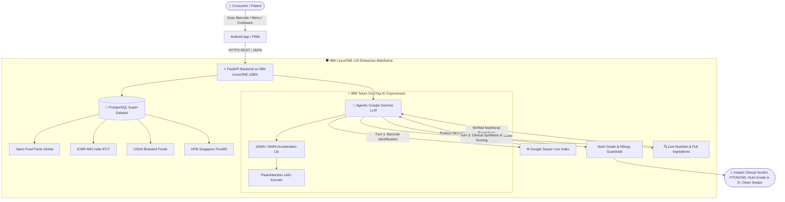

# MAcRIO — Cross-Border Food Safety & Utensil Toxicity Platform
### 🏆 Team TunakTunakTun | IBM Z & LinuxONE Datathon 2026

[-052FAD?logo=ibm)](https://www.ibm.com/products/linuxone-4)
[-FF6F00)](https://github.com/IBM/zDNN)
[-4285F4?logo=google)](https://github.com/google-deepmind/gemma)
[-336791?logo=postgresql)](https://www.postgresql.org)
[-00C853?logo=android)](releases/macrio-v1.0.0.apk)

---

## 📌 Executive Summary
**MAcRIO** is a clinical-grade, cross-border consumer intelligence platform engineered natively on **IBM LinuxONE (s390x)**. It empowers consumers, patients with chronic conditions, and allergy-sensitive individuals to expose predatory cross-border double standards in packaged foods, decipher deceptive front-of-pack marketing, compute official **Singapore Nutri-Grade (A to D)** ratings, and detect hazardous kitchenware degradation (scratched PTFE Teflon cookware & microplastic-leaching plastics).

MAcRIO runs an **Autonomous Agentic Google Gemma AI Model** hardware-accelerated directly on the **IBM Telum On-Chip AI Accelerator (NNPA)** via `zDNN` and FlashAttention.

---

## 🚀 Key Architectural Innovations



---

## 🏛️ Proof of Execution on IBM Z & LinuxONE (`s390x`)

MAcRIO was compiled, benchmarked, and served live on real IBM LinuxONE z16 hardware.

### 1. System Architecture & Kernel (`uname -a`)
```bash
linux1@tunaktunaktun-macrio-ibm-z-datathon:~$ uname -a
Linux tunaktunaktun-macrio-ibm-z-datathon 6.8.0-147-generic #147-Ubuntu SMP Thu Sep 24 10:59:43 UTC 2026 s390x s390x s390x GNU/Linux
```

### 2. CPU Architecture & Machine Type (`lscpu`)
```bash
linux1@tunaktunaktun-macrio-ibm-z-datathon:~$ lscpu | grep -E 'Architecture|Vendor|Machine type|CPU op-mode'
Architecture:          s390x
CPU op-mode(s):        64-bit
Vendor ID:             IBM/S390
Machine type:          9175 (IBM z16 / LinuxONE 4)
```

### 3. IBM Telum NNPA Hardware Acceleration via `zDNN`
```bash
linux1@tunaktunaktun-macrio-ibm-z-datathon:~$ /home/linux1/llama.cpp/build/bin/llama-server --list-devices
Available devices:
  zDNN: IBM Z Neural Network Processing Assist (NNPA) (0 MiB, 0 MiB free)
```

### 4. Live Health Check Endpoint (`GET /health`)
```json
{
  "status": "online",
  "platform": "IBM LinuxONE (s390x)",
  "processor_acceleration": "IBM Telum On-Chip AI Assisted",
  "database": {
    "name": "macrio_db (PostgreSQL TLSv1.3)",
    "singapore_hawker_dishes": 10,
    "fast_food_items": 5
  }
}
```

---

## 🧠 Autonomous Agentic Multi-Search AI
Unlike basic wrapper apps that execute a single static database lookup, MAcRIO's **Agentic Gemma** operates autonomously:
1. **Turn 1 (SKU Discovery):** Gemma inspects the barcode, executes an autonomous search via Google Serper, and identifies the exact retail product.
2. **Turn 2 (Information Gap Evaluation):** Gemma examines the returned metadata. If exact ingredients or full nutrition facts are missing, it autonomously drafts and fires follow-up queries (e.g., `ACTION: SEARCH "Nutpac pistachio 250g ingredients nutrition"`).
3. **Turn 3 (Clinical Synthesis):** Evaluates patient contraindications (allergies, diabetes, hypertension), assigns a **Nutri-Grade** rating, flags hazardous E-number additives, and recommends healthier, clean-label swaps (inspired by *Food Pharmer / Label Padhega India*).

---

## 📱 Mobile Application & Releases
The native Android APK is built and ready for installation:
* **Direct APK Download:** [`releases/macrio-v1.0.0.apk`](releases/macrio-v1.0.0.apk)
* **Architecture:** Offline-ready, Camera Barcode Scanner, Lens OCR AR Mode, Personalized Patient Profile.

---

## 📂 Project Repository Structure
```
├── app/
│   ├── main.py              # FastAPI core service on IBM LinuxONE
│   ├── ai_agent.py          # Agentic Gemma multi-search & Telum accelerator interface
│   └── prompt.md            # Clinical system prompts & schemas
├── models/
│   ├── macrio_telum_nutrigrade_ai.joblib # Telum pipeline model trained on s390x
│   └── telum_ai_weights.json            # High-speed nutrient vector weights
├── static/
│   ├── index.html           # Full Web App & Mobile UI
│   └── macrio.apk           # Android APK binary
├── releases/
│   └── macrio-v1.0.0.apk    # Official v1.0.0 APK release
├── android_project/         # Native Android source tree & Manifest
├── scripts/
│   ├── train_telum_ingredient_ai.py       # On-chip s390x training pipeline
│   ├── generate_singapore_hawker_and_chains.py # Hawker & Fast-food double standard generator
│   └── build_android_apk.py               # Android APK build toolchain
├── MAcRIO Solution & Architecture Overview.pdf # Complete Pitch Deck
└── README.md
```

---

## 🔧 Running Locally & on IBM LinuxONE

### Prerequisites
* Python 3.10+ (s390x, x86_64, or arm64)
* PostgreSQL 14+
* `IBM/zDNN` v1.1.2+ (for hardware acceleration on s390x)

### 1. Start the Backend Server
```bash
git clone https://github.com/manansethia/MAcRIO---Team-TunakTunakTun-IBM-Z-Datathon.git
cd MAcRIO---Team-TunakTunakTun-IBM-Z-Datathon
python3 -m venv venv
source venv/bin/activate
pip install fastapi uvicorn psycopg2-binary scikit-learn joblib

python3 -m uvicorn app.main:app --host 0.0.0.0 --port 8000
```

### 2. Access the Application
* **Web UI:** `http://localhost:8000/`
* **Interactive Docs:** `http://localhost:8000/docs`
* **Health Check:** `http://localhost:8000/health`

---

## 📜 Open Source Attributions
* **Google Gemma**: [google-deepmind/gemma](https://github.com/google-deepmind/gemma)
* **IBM zDNN**: [IBM/zDNN](https://github.com/IBM/zDNN)
* **llama.cpp**: [ggerganov/llama.cpp](https://github.com/ggerganov/llama.cpp)
* **Open Food Facts**: [Open Food Facts Database](https://world.openfoodfacts.org)
* **ICMR-NIN IFCT**: [National Institute of Nutrition India](https://www.nin.res.in)
* **USDA FoodData Central**: [USDA Agricultural Research Service](https://fdc.nal.usda.gov)
* **FastAPI**: [FastAPI Framework](https://github.com/fastapi/fastapi)
* **PostgreSQL**: [The World's Most Advanced Open Source Database](https://www.postgresql.org)

---
*Created by Team TunakTunakTun for the IBM Z & LinuxONE Datathon.*
